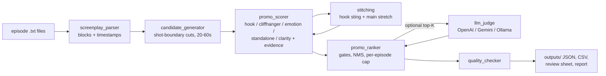

# Kuku AI Promo Finder

Finds and ranks 20–60 second promo clips in microdrama screenplays. Every promo comes with exact episode and timestamp ranges, a hook, a cliffhanger, a one-line reason it works, and the evidence behind its score.

Built for **Kuku AI Generalist Assignment, Problem 1: Find the Promos**.

> **Honest status:** the submitted results were produced by the **rule-based scorer only**. The optional LLM judge (OpenAI / Gemini / Ollama) is implemented and tested with a mock provider. It was **not** run on the pack, because no LLM endpoint was reachable from the build environment. Nothing in `outputs/` was written by an LLM.

---

## 1. Problem

Today an editor watches every episode to pick promo moments by hand. A good promo:

* opens on a **hook**, something in the first 3 seconds that stops a scrolling viewer;
* ends on a **cliffhanger**, cutting at an unresolved moment;
* **makes sense on its own** to someone who has never seen the show;
* runs **20–60 seconds**, as one stretch or a few joined moments.

The tool reads the screenplay, which already has a timestamp for every shot, line and action, and does this search automatically.

## 2. Features

| Implemented | Notes |
|---|---|
| Screenplay parser | Episode, scenes, CAMERA / ACTION / SOUND FX / dialogue blocks, speaker, delivery tag, timestamps. Handles header-case variants (the pack's Episode 6 uses `SCENE START:`). |
| Editorially valid cuts | Clips start and end only on camera-shot boundaries and **never mid-line**. |
| Exhaustive candidates | Every valid start/end pair 20–60 s long, about 12k per 50 episodes. |
| Multi-segment promos | A 2–8 s hook "sting" plus a main stretch. The sting must come earlier, so it can't spoil the ending, and must share a character with the main stretch. |
| Transparent scoring | 5 criteria, weights in `config.py`, every point logged as evidence. |
| De-duplication | Greedy non-maximum suppression: at most 15% shared screen time per clip, no two promos with the same opening 3 s, at most 2 promos per episode. |
| Confidence tiers | `post-first` / `review` / `weak`, so a weak episode's best moment is not presented as a strong promo. |
| Human-in-the-loop | `review_sheet.csv` to fill in; `--overrides` JSON to reject or pin promo IDs. |
| Quality checks | 15 automated checks, including a reproducibility run. Written to `quality_report.json`. |
| Optional LLM judge | Re-scores the shortlist only. Swappable provider, disk cache, falls back to rules on any error. |
| Zero dependencies | Pure Python 3.9+ standard library. `reportlab` is needed only to rebuild the PDF. |

## 3. Architecture



```
promo_finder.py          CLI entry point; writes all outputs
config.py                every weight, threshold, lexicon, LLM setting
src/screenplay_parser.py text -> Episode/Scene/Block objects (pure parsing, no scoring)
src/candidate_generator.py valid cut points, single + stitched candidates
src/promo_scorer.py      the 5 criteria + template explanations from real script text
src/promo_ranker.py      pipeline orchestration, de-duplication, LLM blending
src/llm_judge.py         provider-agnostic LLM judge (stdlib urllib, cached)
src/quality_checker.py   input/output validation, reproducibility fingerprint
tests/test_pipeline.py   16 unit tests on a fictional sample (no Kuku data needed)
examples/                fictional 2-episode screenplay in the same format
```

## 4. Installation

```bash
git clone <repo-url> Kuku-AI-Promo-Finder
cd Kuku-AI-Promo-Finder
python3 --version            # 3.9 or newer
pip install -r requirements.txt   # optional: only reportlab, for rebuilding docs/solution.pdf
```

## 5. Running it

```bash
# 1. Quick demo on the fictional sample (works straight after cloning)
python3 promo_finder.py --input examples --output outputs_demo

# 2. Real run: put the episode .txt files in input/ (or point --input at them)
python3 promo_finder.py --input input --output outputs

# 3. Same, and verify that two runs give identical results
python3 promo_finder.py --input input --output outputs --check-repro

# 4. Ablation: ignore the writers' literal "cliffhanger" SFX notes
python3 promo_finder.py --input input --output outputs_nocues --no-script-cues

# 5. Human corrections: reject or force-include promo IDs
python3 promo_finder.py --input input --overrides examples/overrides.example.json

# 6. Optional LLM judge (blends 50/50 with rules on the top-40 shortlist)
export PROMO_LLM_PROVIDER=ollama PROMO_LLM_MODEL=llama3.1        # free, local
# export PROMO_LLM_PROVIDER=gemini GEMINI_API_KEY=...            # free tier
# export PROMO_LLM_PROVIDER=openai OPENAI_API_KEY=...            # or any OpenAI-compatible URL via OPENAI_BASE_URL
python3 promo_finder.py --input input --output outputs_llm

# Tests
python3 -m unittest discover -s tests -v
```

The full 50-episode pack runs in about 7 seconds on one CPU core.

**Running on a new show:** drop its episode files into any folder and pass `--input <folder>`. Nothing in the code is specific to this show. Character names, for example, are learned from each run's speaker list.

## 6. Input format

One UTF-8 `.txt` per episode, in the format of the Kuku pack (see `examples/episode-001-sample.txt`):

```
EPISODE NUMBER: Episode 1
EPISODE LOGLINE: ...
--- SCRIPT START ---
SCENE 01
Scene heading: INT. GRAND HALL - NIGHT
Scene start: 00:00.00
Scene end: 00:57.00
**CAMERA:**
Start: (00:10.50) | End: (00:13.50)
Medium shot as Selene spins and slaps Mira hard across the face.
**SELENE (Furious):**
Start: (00:10.70) | End: (00:13.40)
"You thief! You were the only one near me!"
--- SCRIPT END ---
```

Timestamps are `MM:SS.cc` from the start of each episode. If the episode number is missing, it is taken from the file name.

## 7. Output format

| File | Contents |
|---|---|
| `ranked_promos.json` | All selected promos, ranked, with segments, scores, evidence, hook, cliffhanger, why, tier and rank reason. |
| `ranked_promos.csv` | The same, flattened for a spreadsheet. |
| `raw_candidates.json` | Unedited top 20 scored candidates per episode (eligible or not), with full evidence, reject reasons and run stats. |
| `all_candidates.csv` | **Every** generated candidate (12,493 for the pack): segments, all five scores, eligibility, reject reasons and selected rank. |
| `review_sheet.csv` | Ranked list with blank columns for a human verdict, adjusted start/end and notes. |
| `quality_report.json` | Pass/fail for every check, score distribution, reproducibility fingerprint. |
| `run_log.txt` | Console output of the submitted run (top 20 printed). |

Sample record (fictional sample run):

```json
{
  "rank": 1, "promo_id": "E001_00m13.50-00m39.50", "tier": "post-first", "type": "single",
  "segments": [{"episode": 1, "start": "00:13.50", "end": "00:39.50",
                "start_sec": 13.5, "end_sec": 39.5, "duration_sec": 26.0}],
  "score": 0.8734,
  "scores": {"hook": 1.0, "cliffhanger": 0.6, "emotion": 0.931, "standalone": 0.95, "clarity": 1.0, "...": "..."},
  "hook": "Opens on SELENE (Furious): \"You thief! You were the only one near me!\" | Visual: Medium shot as Selene spins and slaps Mira hard across the face.",
  "cliffhanger": "Cuts on MIRA (Screaming): \"No! Let me go!\" | Visual: The doors slam against the stone walls with a thunderous boom. | Left open: tension held at the cut, new arrival",
  "why_it_works": "Works because it opens on a physical action and a shocking line at once, someone walks in at the cut and who-is-who is clear without backstory.",
  "evidence": {"hook": ["+0.35 physical event in first 3s (crashes, slaps)", "+0.15 dialogue starts 0.2s in",
                        "+0.25 shocking line (thief)", "+0.10 exclamation", "+0.20 explosive delivery (Furious)",
                        "+0.05 line lands within 1s"]}
}
```

## 8. Ranking methodology

**Score = Σ weight × criterion × duration multiplier − stitch penalty.** Every criterion is 0–1 and every adjustment is recorded in `evidence`.

| Criterion | Weight | What earns or loses points |
|---|---|---|
| Hook (first 3 s) | 0.27 | + physical event (slap, grab, lunge, explosion) · − opens just *after* an impact it misses · + shocking line (married, poison, gallows…) · + exclamation or question · + explosive delivery tag · − opens on a reply ("Because…", "…") · − silent or establishing open |
| Cliffhanger (last ~6 s) | 0.27 | + ends on a question, + **the answer exists in the script but is cut** · + threat or stakes in the last line · + trailing or interrupted line · + tension cue (freeze, drone, glares) · + someone arrives · + cut matches the episode's own ending · − tension resolves (embrace, thank you, safe) · − energy drops · − dead air |
| Emotional intensity | 0.16 | Mean and peak delivery-tag intensity (a 3-level lexicon built from the 620 distinct tag words in the pack) plus physical beats |
| Standalone | 0.15 | − off-screen characters named · − backstory phrases ("remember", "again") · + relationship anchors (husband, sister, Duke) · − more than 4 speakers · − cross-episode jump |
| Narrative clarity | 0.15 | Dialogue covers 35–85% of the clip, 2–3 speakers, back-and-forth turns, − each scene change |
| Duration | gate | Hard 20–60 s. Multiplier 1.0 inside 25–50 s, falling to 0.9 at the limits. |

Then: **gates** (hook ≥ 0.30 and cliffhanger ≥ 0.30), **de-duplication** (greedy, best first, ≤15% shared time, no shared opening, ≤2 per episode), an optional **LLM blend** on the top 40, and **tiers** (≥0.75 post-first, ≥0.60 review, else weak). Ties break on promo ID, so the ranking is deterministic.

## 9. Results on the Kuku pack (submitted run)

* 50/50 episodes parsed (3,727 blocks, 1,487 dialogue lines, 102.7 min of screen time), 0 parser warnings.
* 12,127 single + 366 stitched = 12,493 candidates; 2,720 passed the gates; **95 promos selected** (≥1 per episode). 18 post-first, 61 review, 16 weak.
* 14 multi-segment promos (8 across episodes). Durations 21.6–57.5 s, median 34.9 s.
* 15/15 automated checks pass, including two runs giving identical fingerprints (`7e9df417611c8331`). All 106 segments were also re-checked against the raw text independently of the parser.
* Ablation without the writers' "cliffhanger" annotations: top 10 identical, 88 promos shared.
* Audit fixes in this version: overlap measured per clip (not per segment), no reused openings, a penalty for clips that start just after their own impact, and stitches that need a character on screen in both parts. Details in `docs/quality_report.md` §2.

The top promos and an honest failure analysis are in [`docs/quality_report.md`](docs/quality_report.md).

## 10. Limitations

* **Keyword-based semantics.** The rules can't tell "no one should **die** hungry" (kindness) from a death threat. This is the main reason the LLM layer exists.
* **Hook score saturates.** Many clips open on "Stop!" or a scream and score 1.0, which compresses the top of the ranking.
* **Standalone ignores pronouns.** "We give them a reason to condemn **her**" scores well even though "her" is never shown.
* **Screenplay ≠ footage.** Scores come from the script's descriptions, not the rendered video, so performance, music and pacing are invisible.
* **Series-level spoilers are not modelled.** The tool doesn't know which reveal is the show's big twist (e.g. Alexander being the Duke).
* **No human evaluation yet.** Weights were tuned by reading outputs, not fitted to editor labels. Treat the tiers as triage, not truth.

## 11. Future improvements (not implemented)

1. Run the LLM judge on the shortlist with a stronger model and compare its ranking with the rules (the blend weight is one config value).
2. Collect editor verdicts through `review_sheet.csv` and fit the weights (e.g. logistic regression on the five criteria).
3. Add a series-level spoiler map from the loglines, so promos never show a late-series reveal.
4. Score rendered video (motion, loudness peaks, face close-ups) alongside the script.
5. Generate cross-episode "story trailer" promos that join 3–4 beats of an arc.

## 12. Confidentiality

Kuku's screenplays are **not** in this repository: `input/` is git-ignored. `outputs/` is also git-ignored by default, because hook and cliffhanger fields quote short lines of dialogue. Share the real outputs only through the private submission Drive link. `outputs_demo/` holds a run on the fictional sample to show the format. An authorised evaluator can run any new show with `--input <folder>`.
